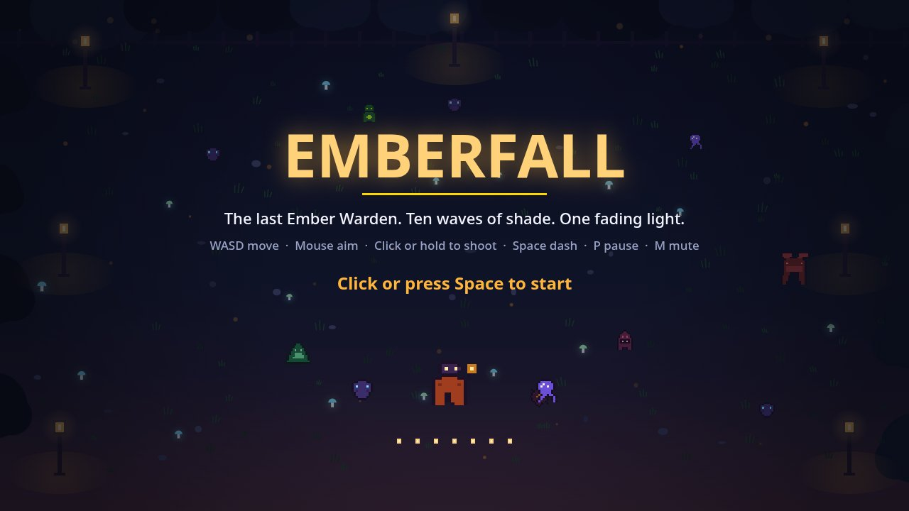
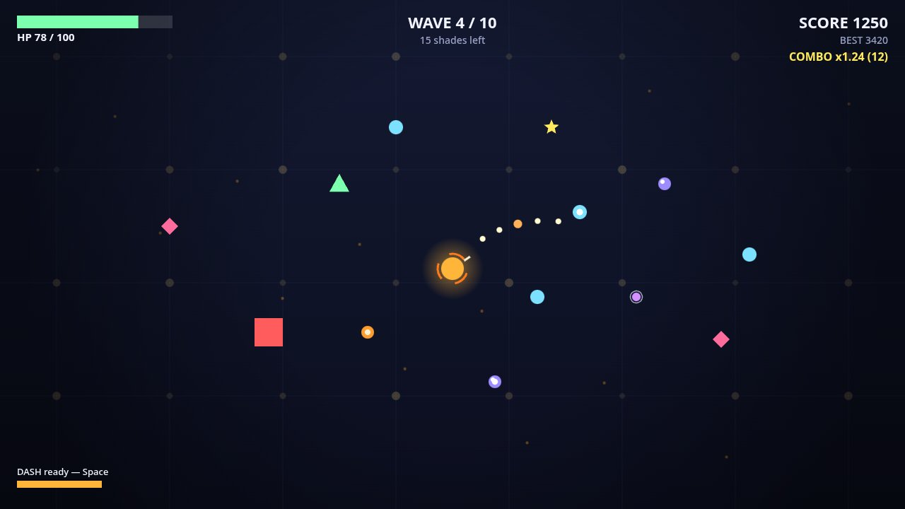

# EMBERFALL — Arena Survival

The last Ember Warden. Ten waves of shade. One fading light.

A complete, original top-down arena survival roguelite that plays offline in a
desktop browser from its own files — no build step, no network, no library.
Built for the [make.fun best game bounty](https://make.fun/bounty/best-game-01).

## Play

Open `game/index.html` in desktop Chrome (or serve the folder with any static
server), then click or press Space to start.

- **WASD / arrows** — move
- **Mouse** — aim
- **Click / hold** — shoot
- **Space / Shift** — dash (brief invulnerability)
- **P / Esc** — pause · **M** — mute · **R** — restart on end screens

Survive all 10 waves to win. After each cleared wave, pick 1 of 3 upgrades:
faster fire, heavier shots, extra projectiles, more speed, more HP, faster
dash, piercing shots, a bigger pickup magnet, critical hits, regeneration,
a Nova Burst, or the Ember Ring — orbiting flame blades that cut shades.
Kills build a combo multiplier; embers heal you; a rare star doubles your
score for 10 seconds.

**Regions.** The ten waves cross three themed regions, each with its own
palette, enemy mix and banner: The Lantern Garden (waves 1–3, indigo dusk,
motes and wisps), The Ember Fields (waves 4–6, scorched amber, spitters and
splitters), and The Hollow Deep (waves 7–10, cold violet, husks, bombers and
healers — elites far more common).

**Ember Shards.** A third pickup: elites and the Hollow King always drop one,
and any kill has a 5% chance. Picking one up gives +50% damage for 8 seconds
(the timer shows in the HUD and the warden wears a pink ring while it lasts);
the run's shard total is shown in the HUD and on the end screen.

**Continue.** The best wave and best score are saved (localStorage) and shown
on the title screen. If a past run passed wave 1, a Continue button appears:
it restarts at that wave and grants one random upgrade per wave skipped, so a
continued run is not underpowered. Click the button or press C; Space or a
click elsewhere starts a fresh run at wave 1.

## Screenshots

| Start | Play | Victory |
| --- | --- | --- |
|  |  |  |

## Structure

- `game/index.html` — canvas and entry point
- `game/src/config.js` — tuning and palette
- `game/src/state.js` — the one state store
- `game/src/input.js` — keyboard and mouse
- `game/src/player.js` — movement, dash, aim, fire, pickups
- `game/src/enemies.js` — five shade types, the boss, contact damage
- `game/src/bullets.js` — player shots and enemy orbs
- `game/src/waves.js` — wave budgets and spawn trickle
- `game/src/upgrades.js` — the upgrade pool and draft
- `game/src/ring.js` — the Ember Ring: orbiting blades, damage and drawing
- `game/src/particles.js` — pooled particles, floating texts, screen shake
- `game/src/audio.js` — synthesized WebAudio effects, no audio files
- `game/src/render.js` — field, entities, HUD, menus, draft
- `game/src/shots.js` — deterministic screenshot scenes
- `game/src/main.js` — boot and the fixed-step loop
- `main.ts` — hands the game in: copies `game/` and `screenshots/` to
  `/output` and writes `dossier.json` with the vendored make.fun library

The simulation runs at a fixed 60 Hz, separate from rendering. All art is
drawn in code and all sound is synthesized — the game loads nothing over the
network.

## License

MIT — see [LICENSE](LICENSE).
