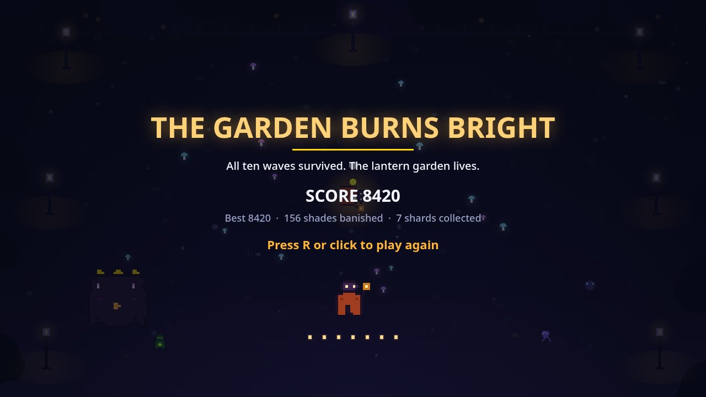

# EMBERFALL — Arena Survival

The last Ember Warden. Ten waves of shade. One fading light.

A complete, original top-down arena survival roguelite that plays offline in a
desktop browser from its own files — no build step, no network, no library.
Built for the [make.fun best game bounty](https://make.fun/bounty/best-game-01).

## Play

Open `game/index.html` in desktop Chrome (or serve the folder with any static
server), then click or press Space to start.

- **WASD / arrows** — move
- **Mouse** — aim
- **Click / hold** — shoot
- **Space / Shift** — dash (brief invulnerability)
- **P / Esc** — pause · **M** — mute · **R** — restart on end screens

Survive all 10 waves to win. After each cleared wave, pick 1 of 3 upgrades:
faster fire, heavier shots, extra projectiles, more speed, more HP, faster
dash, piercing shots, a bigger pickup magnet, critical hits, or regeneration.
Kills build a combo multiplier; embers heal you; a rare star doubles your
score for 10 seconds. Wave 10 brings the Hollow King, who charges, fires
radial bursts and summons motes.

## Screenshots

| Start | Play | Victory |
| --- | --- | --- |
|  |  |  |

## Structure

- `game/index.html` — canvas and entry point
- `game/src/config.js` — tuning and palette
- `game/src/state.js` — the one state store
- `game/src/input.js` — keyboard and mouse
- `game/src/player.js` — movement, dash, aim, fire, pickups
- `game/src/enemies.js` — five shade types, the boss, contact damage
- `game/src/bullets.js` — player shots and enemy orbs
- `game/src/waves.js` — wave budgets and spawn trickle
- `game/src/upgrades.js` — the upgrade pool and draft
- `game/src/particles.js` — pooled particles, floating texts, screen shake
- `game/src/audio.js` — synthesized WebAudio effects, no audio files
- `game/src/render.js` — field, entities, HUD, menus, draft
- `game/src/shots.js` — deterministic screenshot scenes
- `game/src/main.js` — boot and the fixed-step loop
- `main.ts` — hands the game in: copies `game/` and `screenshots/` to
  `/output` and writes `dossier.json` with the vendored make.fun library

The simulation runs at a fixed 60 Hz, separate from rendering. All art is
drawn in code and all sound is synthesized — the game loads nothing over the
network.

## License

MIT — see [LICENSE](LICENSE).
